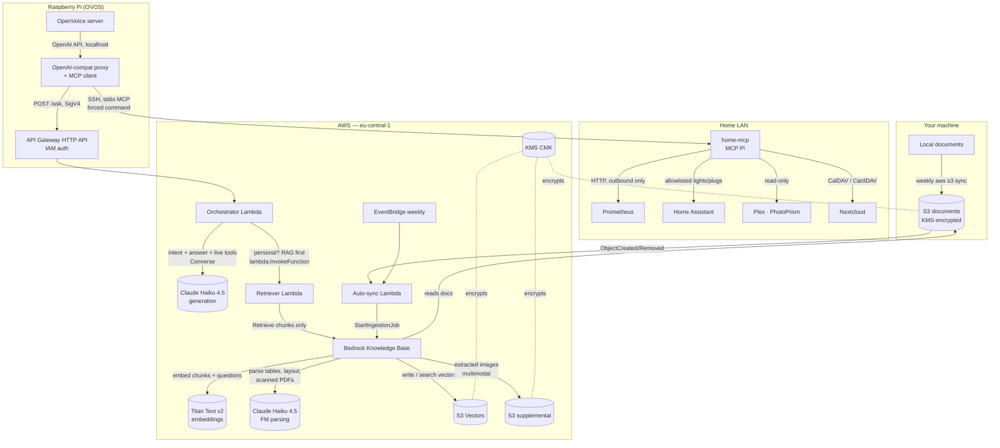

# familIA

A private, low-cost **RAG assistant over your own family documents**, built
entirely with Terraform on AWS.

Documents live encrypted in S3 (synced from your local disk). Amazon Bedrock
Knowledge Bases index them into a cheap **S3 Vectors** store. Two independent
Lambda modules serve questions: a **retriever** (pure RAG — Bedrock `Retrieve`,
returns chunks only, no generation) and an **orchestrator** in front of it that
classifies intent, auto-detects the person/topic, and — for personal/family
questions — always queries the RAG first. A Raspberry Pi running an OpenVoice
server calls the orchestrator (`POST /ask`) — authenticated with IAM/SigV4, so
there are no shared secrets.

> **Privacy by design:** no personal data is ever committed to this repo. The
> family context comes exclusively from the documents you index (RAG), never
> from prompts or code. See [Privacy & secrets](#privacy--secrets).

---

## Architecture



**Why these choices**

| Concern | Choice | Rationale |
|---|---|---|
| Vector store | **S3 Vectors** | No OpenSearch Serverless OCU charges; pay-per-use. Cheapest managed option. |
| Embeddings | **Titan Text v2 @ 1024 dims** | Strong retrieval quality; dims are immutable so we pick well once. |
| Chunking | **Hierarchical** | Retrieves precise child chunks, feeds larger parent chunks for context. |
| Parsing | **Bedrock FM parsing** | Understands tables, layout and scanned PDFs — the biggest lever on quality. |
| RAG isolation | **Retriever = retrieve-only** | The RAG returns chunks; all language generation lives in the orchestrator, so the layers are fully decoupled and independently testable. |
| Routing | **Orchestrator Lambda (Haiku)** | Classifies personal vs general, auto-detects owner/topic (from a deploy-injected allowlist), queries RAG first for personal questions, stops if nothing is found (no general-knowledge fallback for personal). |
| Auth | **IAM / SigV4** | Strong auth, zero extra cost, no secrets in the repo. |
| Encryption | **Customer-managed KMS key** | Auditable, revocable; encrypts docs, vectors and logs. |

---

## Repository layout

```
terraform/            # all infrastructure as code
  versions.tf         # provider + S3 remote-state backend (partial config)
  variables.tf        # all knobs; generic defaults, no PII
  kms.tf              # customer-managed encryption key
  s3_documents.tf     # documents bucket (KMS, versioned, public access blocked)
  s3_vectors.tf       # S3 Vectors bucket + index (immutable dims/metric)
  iam_bedrock_kb.tf   # least-privilege role for the Knowledge Base
  knowledge_base.tf   # Bedrock KB + data source (hierarchical + advanced parsing)
  lambda_query.tf     # retriever Lambda (retrieve-only) + role + logs
  lambda_orchestrator.tf # orchestrator Lambda + role + /ask route (gated)
  api_gateway.tf      # HTTP API (IAM auth) + Raspberry Pi IAM user
  lambda_auto_sync.tf # reindex Lambda (S3 event + weekly schedule)
  outputs.tf
  terraform.tfvars.example
lambda/
  query/handler.py         # retriever: Bedrock Retrieve, returns chunks only
  orchestrator/handler.py  # routing + language layer (intent, RAG-first, answer)
  auto_sync/handler.py     # StartIngestionJob with overlap guard
scripts/
  bootstrap_backend.sh    # one-time: create the state bucket
  create_pi_credentials.sh# create the Pi IAM access key (secret stays local)
  sync_docs.sh            # aws s3 sync local -> bucket (use in cron)
  generate_metadata.py    # folder-derived metadata sidecars (called by sync_docs.sh)
  familia.config.example.json # owners/options template (copy to familia.config.json)
  ingest.sh               # first / full ingestion in batches (>1000 files)
  ovos_openai_proxy.py    # OpenAI-compatible proxy: OVOS -> /ask (SigV4)
  familia_mcp_bridge.py   # proxy-side MCP client (live home tools over SSH)
  requirements-proxy.*    # pinned, hashed deps for the proxy venv (.in -> .txt)
  familia-ovos-proxy.service.example # systemd unit for the proxy on the Pi
tests/                    # orchestrator + proxy tests (pytest)
```

**Related repositories**

| Repo | What it holds |
|---|---|
| [home-mcp](https://github.com/mahdsip/home-mcp) | The home MCP server on the MCP Pi (`familia-mcp`): Prometheus, Home Assistant, Plex, PhotoPrism and Nextcloud tools, installer and allowlist template. |
| [monitoring](https://github.com/mahdsip/monitoring) | The home monitoring stack the assistant reads from: Prometheus, Grafana network map, temperature alerts and automated OS / Docker updates. |

---

## Prerequisites

- Terraform >= 1.5, AWS provider >= 6.0 (installed automatically).
- AWS credentials for the target account (`aws sso login` or a profile).
- Bedrock **model access enabled** in `eu-central-1` for the embedding,
  parsing and generation models (Bedrock console → Model access).

---

## Deploy

```bash
# 1. One-time: create the remote-state bucket (pick a globally-unique name)
AWS_PROFILE=<profile> ./scripts/bootstrap_backend.sh my-familia-tfstate-<accountid>

# 2. Configure your variables
cd terraform
cp terraform.tfvars.example terraform.tfvars   # edit if desired (defaults are fine)

# 3. Initialise with the remote backend
terraform init \
  -backend-config="bucket=my-familia-tfstate-<accountid>" \
  -backend-config="key=familia/terraform.tfstate" \
  -backend-config="region=eu-central-1" \
  -backend-config="use_lockfile=true"

# 4. Phase 1 — deploy base infra (empty bucket + vector index, no KB yet)
#    terraform.tfvars keeps enable_knowledge_base = false
terraform apply
```

The deploy is intentionally **two-phase** so the vector store and Knowledge
Base start empty and are only built once your documents exist:

- **Phase 1 (`enable_knowledge_base = false`, the default):** creates the empty
  documents bucket, the S3 Vectors store, IAM, the API and the query Lambda.
- Now **load your documents** from your data machine (see below).
- **Phase 2 (`enable_knowledge_base = true`):** creates the Knowledge Base, its
  S3 data source and the auto-sync Lambda, then indexes what's in the bucket.

```bash
# After documents are uploaded, flip the switch and apply again:
terraform apply -var="enable_knowledge_base=true"
# (or set enable_knowledge_base = true in terraform.tfvars)
```

- **Phase 3 (optional, `enable_orchestrator = true`):** adds the orchestrator
  Lambda and the `POST /ask` route in front of the RAG (see
  [The orchestrator layer](#the-orchestrator-layer-routing)). Requires the
  Knowledge Base. Without it, the Pi calls the retrieve-only `/query` directly.

Prefer local state? Comment out the `backend "s3" {}` block in `versions.tf` and
run `terraform init` with no backend config. Never commit the `.tfstate` file.

After each apply, note the outputs (`query_api_url`, `docs_bucket`,
`knowledge_base_id`).

---

## Indexing strategy (precision + provenance)

Retrieval quality is driven by three things, all wired in:

1. **Hierarchical chunking + foundation-model parsing** — precise child chunks
   with parent-chunk context, and a model that understands tables, layout and
   scanned PDFs.
2. **Folder-derived metadata.** Your documents are organised as
   `topic/owner/[subfolders...]/file.ext`. `scripts/generate_metadata.py` walks
   the tree and writes a `<file>.metadata.json` sidecar next to each document:

   ```jsonc
   // salud/alice/informes/analisis.pdf.metadata.json
   {
     "metadataAttributes": {
       "topic": "salud", "owner": "alice", "subpath": "informes",
       "doc_type": "pdf", "file_name": "analisis.pdf",
       "source_path": "salud/alice/informes/analisis.pdf"
     }
   }
   ```

   Bedrock indexes these as **filterable** attributes in S3 Vectors, so a query
   can be narrowed to a person or subject — a big precision win. (The raw chunk
   text is stored non-filterable to stay within the S3 Vectors metadata size
   budget.) These keys are immutable once the index exists, so they're pinned.
3. **Source always returned.** Every answer includes a `sources` array with the
   S3 URI plus `topic`/`owner`/`source_path` (and dates, see below) for each
   retrieved chunk, so you always know which file the information came from.
4. **File-property enrichment.** Each sidecar also carries `modified_date`,
   `file_size_kb`, and — for JPEGs with EXIF — `captured_date` (the real
   photo-taken date, parsed with no external dependency). These are filterable
   (so you can query date ranges) and returned with each chunk, giving the model
   temporal context.

   Note on "use the most recent X" (e.g. the newest DNI photo): RAG ranks by
   relevance, not date, and S3 Vectors has no sort-by-metadata. The dates are
   *returned* so the model can reason over them — phrase the question to lean on
   that, e.g. "según el DNI más reciente, ¿cuál es el número?", and the model
   prefers the newest document among those retrieved. For hard guarantees, pass
   a date `filter`.
5. **Discriminator fields** (filterable, future-proofing a mixed-media index):
   - `content_type` — `document` / `photo` / `film` / `music`, auto-derived from
     the extension (override via `options.content_type_map`). Lets you scope
     retrieval to one media kind.
   - `provider` — where this record's metadata came from, looked up per
     content category from `options.providers` (e.g. `documents:
     personal_backup`, `images: photoprism`, `movies`/`music`: `plex`). As one
     config drives documents, photos, films and music, this records the source
     of each category. Only emitted when the category is configured.
   - `year` — derived from `captured_date`/`modified_date`; a cheap, common
     filter.

   - `place` — optional city/country. Reserved in the schema but NOT set by this
     pipeline (no manual maintenance). The PhotoPrism importer will populate it
     per photo from PhotoPrism's already-geocoded place names. This pipeline
     never reverse-geocodes GPS.

   These are groundwork for importing richer catalogues (PhotoPrism photos,
   Plex films/music). The recommended pattern for media is to synthesize a small
   text record per item (title + summary + people/cast + genre) as the indexed
   "document", with structured fields mapped onto a canonical schema so all
   sources share field names (e.g. `people` for photo faces and film cast).

### Complete metadata field reference

| Field | Tier | Source | Notes |
|---|---|---|---|
| `topic` | filterable | folder | subject area |
| `owner` | filterable | folder | person (normalized alias) |
| `owner_name` | returned | config | full display name |
| `subpath` | returned | folder | sub-folders below owner |
| `doc_type` | filterable | extension | pdf, jpg, ... |
| `file_name` | returned | file | original name |
| `source_path` | returned | path | for citations |
| `content_type` | filterable | extension | document/photo/film/music |
| `provider` | filterable | config (`providers` per category) | e.g. personal_backup / photoprism / plex |
| `year` | filterable | date | derived YYYY |
| `modified_date` | filterable | filesystem | ISO date |
| `captured_date` | filterable | EXIF | photo-taken date (JPEG) |
| `file_size_kb` | filterable | filesystem | size |
| `place` | filterable | PhotoPrism importer (future) | optional; never from raw GPS; not set by this pipeline |

## Load your documents

The document machine does not need the Terraform repo — just Python 3, AWS CLI,
and three files from `scripts/`: `sync_docs.sh`, `generate_metadata.py`, and
your own `familia.config.json`. Copy them over and run from there.

**Credentials** are resolved via the standard AWS chain, so use whichever you
already have — no `AWS_PROFILE` required:

```bash
# Option 1: exported environment variables (temporary or long-lived)
export AWS_ACCESS_KEY_ID=...        # + AWS_SECRET_ACCESS_KEY
export AWS_SECRET_ACCESS_KEY=...    # + AWS_SESSION_TOKEN if temporary
export AWS_REGION=eu-central-1

# Option 2: a named profile
export AWS_PROFILE=<name>

# Option 3: SSO login (aws sso login --profile <name>)
```

`sync_docs.sh` runs a credential preflight (`aws sts get-caller-identity`) and
prints the resolved identity, failing fast with guidance if none is found.

**One-time setup on the document machine:**

```bash
# Map your folder aliases to display names (this file is gitignored — it holds
# real names and must never be committed).
cp scripts/familia.config.example.json scripts/familia.config.json
$EDITOR scripts/familia.config.json
```

The `owners` map tells the metadata generator which folder names are people, so
it can **auto-detect** whether your tree is `topic/owner/...` or `owner/topic/...`
per document (matching is case- and accent-insensitive). Set `options.layout`
to `"topic_owner"` or `"owner_topic"` to force an order instead of `"auto"`.

**Every sync (manual or weekly cron):**

```bash
# Args: <bucket> <prefix> <root> [<root> ...]   (prefix may be "")
# Regenerates metadata from the CURRENT folder structure (so reorganising
# folders updates metadata), then mirrors documents + sidecars to S3.
AWS_PROFILE=<profile> ./scripts/sync_docs.sh \
  "<docs-bucket-name>" documents "$HOME/Documents/Family"

# Multiple roots: each is mirrored into its OWN subprefix (named after the
# root's folder) so they never delete each other under --delete:
AWS_PROFILE=<profile> ./scripts/sync_docs.sh \
  "<docs-bucket-name>" documents "$HOME/Documents/Family" "$HOME/Scans"

# Override a root's subprefix with "path=subname":
AWS_PROFILE=<profile> ./scripts/sync_docs.sh \
  "<docs-bucket-name>" documents "/mnt/nas/health=salud" "/mnt/nas/school=colegio"

# Preview metadata changes for a root without writing or uploading anything:
python3 scripts/generate_metadata.py "$HOME/Documents/Family" --dry-run --prune
```

Each root is synced recursively (all subfolders). `topic`/`owner` metadata is
derived from the folders *inside* each root, so the subprefix does not affect
your `topic/owner` scheme.

**Metadata sidecars are never written to your local folders.** `sync_docs.sh`
generates the `.metadata.json` files into a temporary staging directory, uploads
them to S3 next to their documents, then deletes the staging dir — so your
source folders stay clean. The documents pass and the sidecar pass are synced
separately; each uses `--delete` scoped by filters so removed documents (and
their now-orphan sidecars) are pruned from S3 without ever risking the other
class of object. (`generate_metadata.py --output-dir <dir>` exposes this
directly if you run it standalone.)

Only document file types are uploaded (an allowlist + the `.metadata.json`
sidecars). Media (`mp4`, `heic`), medical imaging (`dcm`) and bundled
application internals (`dll`, `jar`, `exe`, `nib`, ...) are intentionally
skipped — Bedrock can't extract text from them and they consume the
advanced-parsing file budget.

Files larger than `options.max_file_size_mb` (default 50, matching Bedrock's
hard limit; `0` disables) are skipped at source — no sidecar, not uploaded — so
they don't cause guaranteed ingestion failures.

The allowlist is configured in `options.allowed_extensions` in
`familia.config.json`, so you manage formats alongside the owners map:

```jsonc
"options": {
  "allowed_extensions": ["pdf","docx","xlsx","txt","jpg","jpeg","png", ...]
}
```

`sync_docs.sh` loads it from there (extensions are lowercased and de-duped; a
leading dot is optional). If the key is absent it falls back to a built-in
default; you can also override ad hoc for one run with `DOC_EXTS="pdf docx"
./scripts/sync_docs.sh ...`. Images (`jpg/png`) are included by default so
scanned documents are indexed via multimodal parsing.

Uploading objects triggers the auto-sync Lambda, which starts a Knowledge Base
ingestion job. A weekly schedule (Sun 03:00 Europe/Madrid) is a safety net.

### First / full ingestion (batches)

With advanced parsing enabled, Bedrock indexes at most **1,000 files per
ingestion job**. If you have more documents than that, run ingestion in batches
until everything is indexed:

```bash
KB=$(cd terraform && terraform output -raw knowledge_base_id)
DS=$(cd terraform && terraform output -raw data_source_id)
./scripts/ingest.sh "$KB" "$DS"      # loops jobs until 0 new docs indexed
```

`failed` counts in the output include the intentionally-skipped media/app files;
inspect `failureReasons` on a job if the number looks wrong.

### Multimodal parsing (scanned images)

`parsing_modality = "MULTIMODAL"` (default) lets the parser read text from
scanned images (JPG/PNG) — photographed IDs, certificates, medical reports —
not just text documents. This requires a **supplemental data storage bucket**
(`<project>-supplemental-<account>`, created automatically) where Bedrock stores
extracted image artifacts. HEIC and DICOM are not supported by Bedrock parsing.

### Source citations

Answers always include a `sources` array (S3 URI + `owner`/`topic`/`source_path`).
The retriever calls Bedrock `Retrieve` and returns each chunk with its location
and metadata; the orchestrator generates the answer and attaches the sources of
the chunks it used, so attribution never depends on a prompt template.

### Models & inference profiles

Newer Bedrock models (e.g. Claude Haiku 4.5) are not available on-demand and are
invoked through a regional **inference profile**. `use_inference_profiles`
(default `true`) and `inference_profile_region_prefix` (default `eu`, keeping
inference in-region for data residency) control this. Titan v2 embeddings run
on-demand and need no profile.

---

## The orchestrator layer (routing)

The Pi talks to the **orchestrator** (`POST /ask`), not the raw RAG. Enable it
in phase 3 (needs the Knowledge Base):

```bash
# In terraform.tfvars (gitignored — safe for the real owner/topic keys):
enable_orchestrator       = true
orchestrator_known_owners = ["owner_a", "owner_b", "kid_a"]   # your folder keys
orchestrator_known_topics = ["health", "car", "work"]         # your folder keys

terraform apply -var="enable_knowledge_base=true"
```

The orchestrator, per question:

1. **Classifies** intent with a cheap LLM (Haiku 4.5) and, restricted to the
   injected owner/topic allowlist, extracts an `owner`/`topic` and an optimized
   search query. The allowlist keeps family names out of the repo and stops the
   model inventing owners.
2. **Routes:**
   - *personal/family* → **always queries the RAG retriever first** (with the
     detected owner/topic filter). If chunks come back, it generates a grounded
     answer with source citations. If nothing is found, it **stops** and says so
     — no fallback to general knowledge (privacy/accuracy first).
   - *general knowledge* → answers from the model's own knowledge; the RAG is
     never consulted.

When the orchestrator is enabled, the Pi's IAM user is restricted to `POST /ask`
only — it cannot reach the raw `/query` retriever. The `/query` route stays for
direct RAG access/debugging from an admin identity.

Recall tuning: `orchestrator_num_results` (default 15) controls how many chunks
the orchestrator pulls per personal question — higher improves recall for
borderline docs (e.g. scanned JPG reports) at a tiny generation-token cost.
`orchestrator_min_score` optionally drops low-score chunks.

## Use it from the Raspberry Pi

OpenVoice OS speaks the **OpenAI Chat Completions API** (a base URL ending in
`/v1`, a Bearer key). The familIA API is IAM/SigV4 with its own contract, so a
tiny **loopback proxy** on the Pi bridges the two:

```
OVOS ──OpenAI (localhost)──► ovos_openai_proxy.py ──SigV4──► API Gateway /ask
```

```bash
# 1. Create the Pi's IAM access key (run once, on your machine)
AWS_PROFILE=<profile> ./scripts/create_pi_credentials.sh \
  "$(cd terraform && terraform output -raw pi_client_user)" pi-credentials.env
# pi-credentials.env is gitignored — copy it to the Pi over scp, never commit it.

# 2. On the Pi: install and configure the proxy
sudo mkdir -p /opt/familia /etc/familia
sudo cp scripts/ovos_openai_proxy.py scripts/familia_mcp_bridge.py /opt/familia/
sudo python3 -m venv /opt/familia/venv
sudo /opt/familia/venv/bin/pip install --require-hashes -r scripts/requirements-proxy.txt

sudo tee /etc/familia/proxy.env >/dev/null <<'EOF'
FAMILIA_API_URL=<paste ask_api_url output, e.g. https://xxxx.execute-api.eu-central-1.amazonaws.com/prod/ask>
AWS_REGION=eu-central-1
PROXY_API_KEY=familia-local
PROXY_HOST=127.0.0.1
PROXY_PORT=8080
AWS_ACCESS_KEY_ID=<from pi-credentials.env>
AWS_SECRET_ACCESS_KEY=<from pi-credentials.env>
EOF
sudo chmod 600 /etc/familia/proxy.env

# 3. Run it as a service (template provided)
sudo cp scripts/familia-ovos-proxy.service.example \
        /etc/systemd/system/familia-ovos-proxy.service
sudo systemctl daemon-reload && sudo systemctl enable --now familia-ovos-proxy

# 4. Smoke-test locally
curl http://127.0.0.1:8080/v1/chat/completions \
  -H "Authorization: Bearer familia-local" -H "Content-Type: application/json" \
  -d '{"model":"familia","messages":[{"role":"user","content":"your question"}]}'
```

Then point OVOS's OpenAI-compatible LLM at the proxy:

| OVOS field | Value |
|---|---|
| Base URL | `http://127.0.0.1:8080/v1` |
| API key | `familia-local` (local only; unrelated to AWS) |
| Model | `familia` |
| Style / length / focus | free text (the orchestrator enforces its own Spanish, concise, documents-first style) |

Request/response contract:

```jsonc
// POST /ask   (SigV4-signed) — the orchestrator
{
  "question": "…",
  "owner": "optional override (normally auto-detected)",
  "topic": "optional override (normally auto-detected)",
  // Live tools only (sent by the proxy, see "Live home tools"):
  "client_time": "2026-10-31T18:05+01:00",
  "tools": [{ "name": "…", "description": "…", "input_schema": {…} }],
  "messages": [ /* Converse transcript echoed back between rounds */ ],
  "tool_results": [{ "tool_use_id": "…", "status": "success|error", "content": {…} }]
}
// 200 OK, intermediate round (live tools):
{ "mode": "tool_use", "tool_calls": [{ "id": "…", "name": "…", "input": {…} }], "messages": […] }
// 200 OK
{
  "answer": "…",
  "mode": "personal" | "personal_not_found" | "general" | "live",
  "owner": "alice" | null,     // what the orchestrator detected
  "topic": "salud" | null,
  "sources": [
    { "uri": "s3://…/salud/alice/informes/analisis.pdf",
      "topic": "salud", "owner": "alice",
      "source_path": "salud/alice/informes/analisis.pdf" }
  ]
}
```

The raw RAG retriever (`POST /query`, admin/debug only) has a different,
retrieve-only contract: it takes `{query, owner?, topic?, filter?,
numberOfResults?}` and returns `{chunks: [{text, score, uri, ...}]}` with no
`answer`.

---

## Live home tools (MCP, return of control)

familIA can answer from **live household data** and act on it (device health,
allowlisted lights and plugs, Plex, photos, calendar, tasks and contacts)
without exposing any home service to AWS or the internet.

- A dedicated **MCP Pi** runs [home-mcp](https://github.com/mahdsip/home-mcp)
  (`familia-mcp`), an MCP server (official SDK, `mcp==2.3.0`) that talks to the
  home services over the LAN (outbound only). Its tools, safety model and
  installer are documented in that repository.
- The **OVOS Pi** proxy is the MCP client. It reaches `familia-mcp` over
  **SSH stdio**: the proxy runs `ssh familia-mcp@mcpserver.local`, and the MCP Pi's
  `authorized_keys` forces the server command for that key (`restrict`: no
  shell, no port forwarding). No new port is opened on either Pi.
- The **orchestrator** runs the Bedrock Converse tool loop but never executes
  tools itself. It returns the model's tool request to the Pi
  (*return of control*), the Pi runs it over MCP, and sends the result back.

```
Pi  -> /ask {question, client_time, tools}                     -> Lambda (classify: live)
Pi  <- {mode: "tool_use", tool_calls, messages}                <- Lambda (Converse)
Pi  -> MCP tools/call over SSH -> familia-mcp -> Prometheus
Pi  -> /ask {question, client_time, tools, messages, tool_results} -> Lambda (Converse)
Pi  <- {mode: "live", answer}                                  <- Lambda
```

Design notes:

- **Backward compatible.** Without `tools`, `/ask` behaves exactly as before.
  If the MCP Pi is down, the proxy declares no tools and familIA keeps
  answering from documents and general knowledge.
- **Stateless Lambda.** The Converse transcript (`messages`) travels with the
  Pi between rounds; the Lambda validates its shape and size, accepts results
  only for the pending `toolUseId`s, and stops after
  `orchestrator_max_tool_rounds` (default 3).
- **Defense in depth.** The proxy only runs tools the MCP server listed. The
  model never writes PromQL: queries come from fixed templates, and device
  names are matched against the live target list and escaped.
- **Timezone from the device.** The proxy sends its local time with its UTC
  offset (`client_time`), so "hoy"/"ayer" resolve in the household's timezone
  without hard-coding one.

### Tools available today

The proxy declares whatever tools home-mcp lists, so new modules need no change
here. Details, examples and limits:
[home-mcp README](https://github.com/mahdsip/home-mcp#readme).

| Module | Example questions |
|---|---|
| Prometheus | "¿Cómo están mis dispositivos?", "¿cuánto se calentó el pimonitor hoy?" |
| Home Assistant | "Apaga las luces del salón", "enciende el ventilador de los niños" |
| Plex | "¿Tenemos Toy Story?", "¿por dónde van los niños en la serie?" |
| Photos | "¿Cuándo fuimos a Asturias?", "¿qué hicimos un día como hoy?" |
| Nextcloud | "¿Qué tengo mañana?", "añade comprar leche", "apúntame dentista el jueves a las cinco" |

**Spoken confirmation.** Some actions (plugs marked `confirm: true`,
appointments, new contacts) are only *parked* by home-mcp, and the model asks a
yes/no question. The proxy keeps the confirmation token on the OVOS Pi, so it
never reaches AWS, and never declares the confirming tools to the model. On
"sí" the proxy confirms locally; "no" cancels; anything else drops the parked
action. The yes/no words and the spoken replies are Spanish by default and can
be overridden with `CONFIRM_*` env vars in `proxy.env`.

### Setup: MCP Pi

Follow [home-mcp: Install / upgrade](https://github.com/mahdsip/home-mcp#install--upgrade-raspberry-pi-os-python-311).
It creates the `familia-mcp` service user, the venv in `/opt/familia-mcp` and
`/etc/familia/mcp.env`, which the SSH forced command below relies on.

### Setup: OVOS Pi (SSH key + proxy)

```bash
# On the OVOS Pi: a dedicated key for the proxy user (no passphrase: unattended)
sudo ssh-keygen -t ed25519 -N "" -C familia-proxy -f /etc/familia/mcp_ed25519
sudo chown ovos:ovos /etc/familia/mcp_ed25519 && sudo chmod 600 /etc/familia/mcp_ed25519
# Pin the MCP Pi host key (verify the fingerprint against the MCP Pi itself)
ssh-keyscan -t ed25519 mcpserver.local | sudo tee /etc/familia/mcp_known_hosts
cat /etc/familia/mcp_ed25519.pub            # copy for the next step

# On the MCP Pi: authorize ONLY the server command for that key
sudo install -d -o familia-mcp -g familia-mcp -m 700 /var/lib/familia-mcp/.ssh
echo 'restrict,command="/opt/familia-mcp/venv/bin/familia-mcp" ssh-ed25519 AAAA...pub-key... familia-proxy' \
  | sudo tee /var/lib/familia-mcp/.ssh/authorized_keys
sudo chown familia-mcp:familia-mcp /var/lib/familia-mcp/.ssh/authorized_keys
sudo chmod 600 /var/lib/familia-mcp/.ssh/authorized_keys
```

Then on the OVOS Pi install the proxy in a venv (see the comments in
`scripts/familia-ovos-proxy.service.example`), and add to `/etc/familia/proxy.env`:

```bash
MCP_SERVER_COMMAND=ssh -F none -T -o BatchMode=yes -o StrictHostKeyChecking=yes -o UserKnownHostsFile=/etc/familia/mcp_known_hosts -o ServerAliveInterval=30 -i /etc/familia/mcp_ed25519 familia-mcp@mcpserver.local
```

On restart the proxy logs `live tools: N available`. Ask "¿cómo están mis
dispositivos?" to test. Set `LOG_LEVEL=DEBUG` to see tool rounds and how many
messages OVOS sends per request.

### Tests

```bash
# Needs home-mcp checked out next to this repo (../home-mcp): its env has mcp/httpx
# and provides the real familia-mcp server the bridge tests start over stdio.
# Orchestrator contract + proxy loop + bridge against a real stdio familia-mcp
uv run --project ../home-mcp --group dev \
  --with boto3==1.43.123 --with requests==2.34.2 pytest --rootdir tests tests
```

---

## Cost notes

Dominant cost is **one-time ingestion** (advanced parsing + embeddings), which
scales with how much you index — hence "index once, well". Ongoing cost for a
home workload is a few dollars/month: the KMS key (~1 USD/month), S3 storage,
S3 Vectors storage/queries, and per-question Bedrock generation (cents). There
are no always-on servers. To cut ingestion cost, set
`enable_advanced_parsing = false` or a smaller `embedding_dimensions`.

---

## Privacy & secrets

This repo is safe to publish publicly:

- **No PII in code or prompts.** The generation prompt is generic; all family
  facts live only in your S3 documents and the derived vectors.
- **No secrets committed.** `.gitignore` blocks `*.tfstate`, `*.tfvars`,
  `.env`, keys, and document file types. Only `*.tfvars.example` is tracked.
- **The Pi's secret key is never in Terraform state** — Terraform creates only
  the IAM user; the access key is generated out-of-band by a script and stored
  locally.
- **Everything sensitive is encrypted** with a customer-managed KMS key, and
  the documents bucket blocks all public access and denies non-TLS requests.

Before committing, run the check in [Validate](#validate).

---

## Validate

```bash
cd terraform
terraform fmt -recursive
terraform validate

# Secret/PII scan before committing (should print nothing):
git grep -nEi "AKIA[0-9A-Z]{16}|-----BEGIN|password|secret_key" -- . ':!*.example' || true
```

---

## Extending to a Bedrock Agent

The current design keeps retrieval (`Retrieve` in the retriever Lambda) and
generation (Converse in the orchestrator, including the live-tools loop)
separate, which is the simplest and cheapest option. If you later need longer
multi-step plans, you can add a Bedrock Agent that references the same
Knowledge Base without changing the storage or ingestion layers.

---

## License

GPL-3.0 — see [LICENSE](LICENSE).
